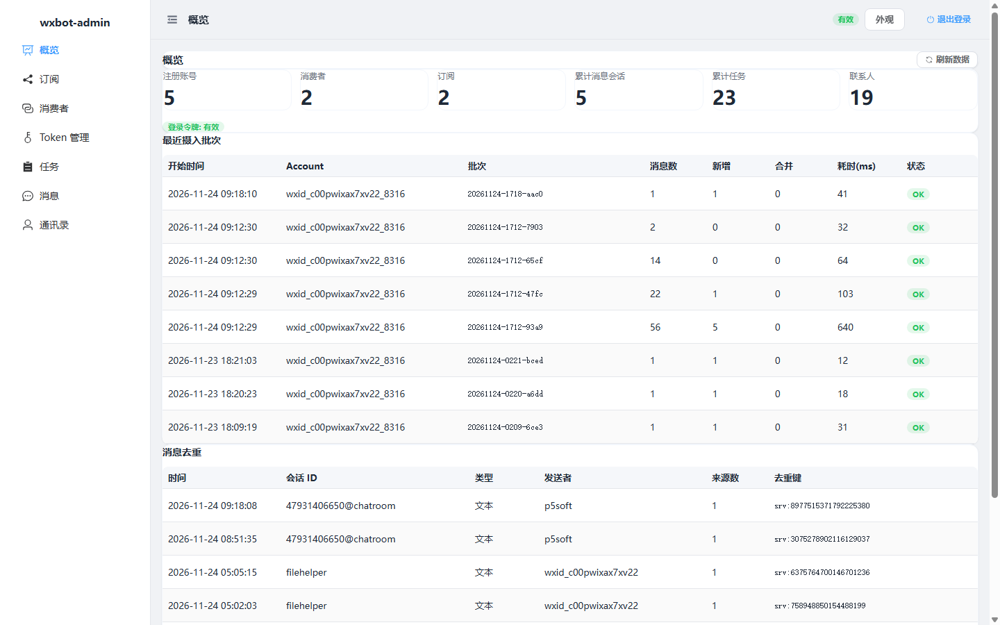
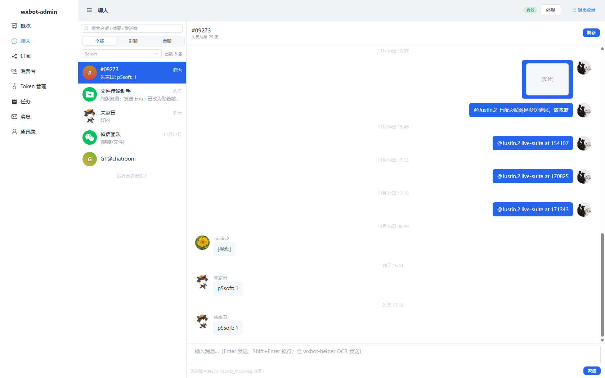
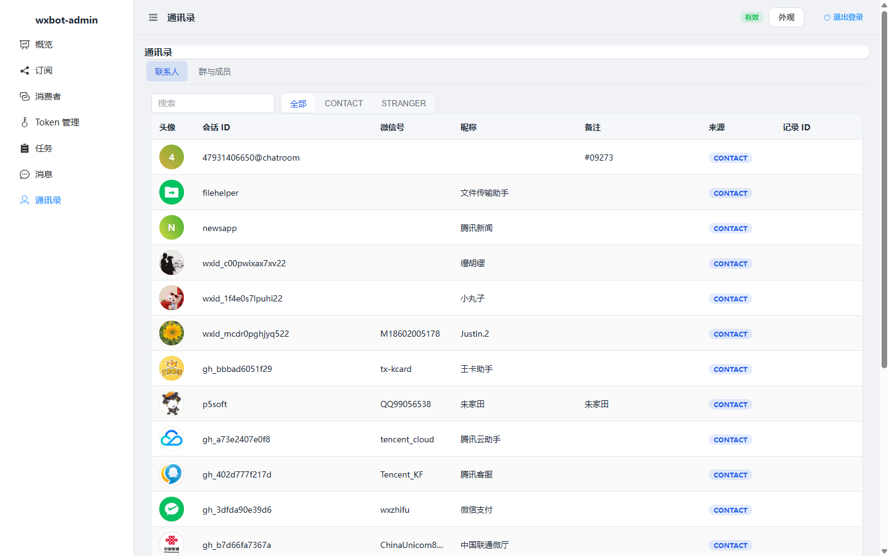
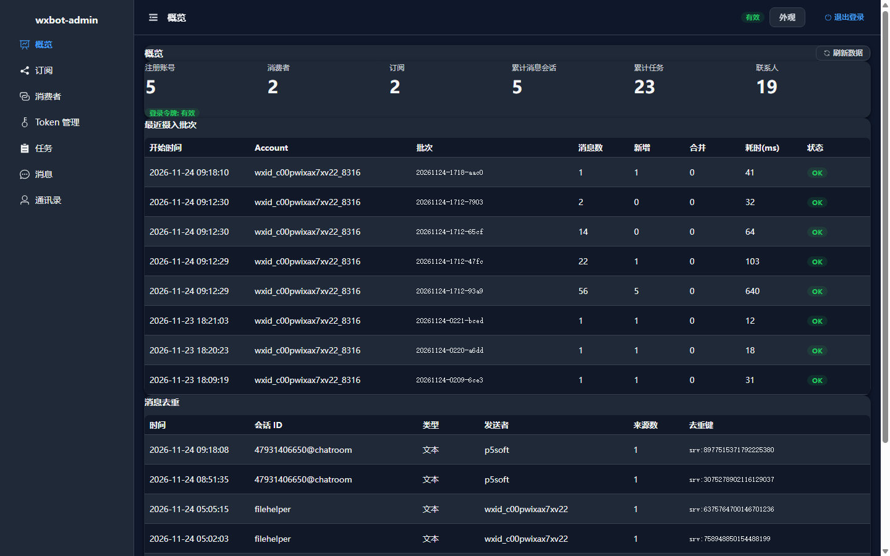
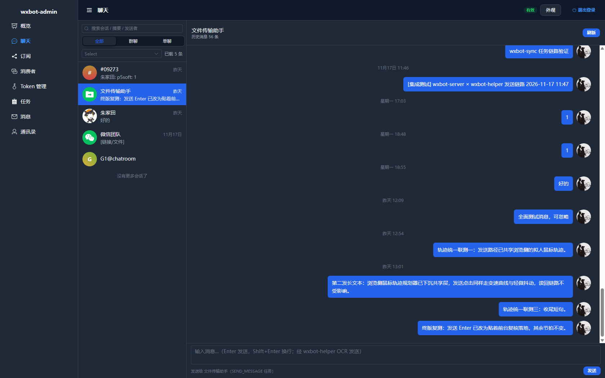

# wechat-sync-server

微信 Windows 客户端本地库 → 自建服务端的**只读同步服务端**（framework4j 1.10.0 + Spring Boot 3.5.16 + MyBatis Plus 3.5.15 + PostgreSQL）。
契约权威：`../API_DESIGN.md`（接口）/`../DB_DESIGN.md`+`../schema.sql`（库）/`../SYNCH_PLAN.md`（同步流程）。本文件只讲怎么跑起来。

## 0. 前置

| 依赖 | 地址 | 说明 |
|---|---|---|
| Java 17 | `C:\Program Files\Java\jdk-17.0.19+10` | Temurin，bash 里要显式 `JAVA_HOME` |
| Maven | `/c/workspace/tools/apache-maven-3.9.9/bin/mvn` | framework4j-all 1.10.0 已本地 install（`fun.commons`），不走 JitPack |
| PostgreSQL | `127.0.0.1:5433` 库 `wechat` 用户 `postgres`/`wxuw` | docker `wxuw-pg` |
| Redis | `127.0.0.1:6379` 无密码 | docker `wxuw-redis`（会话/幂等/限流/雪花 worker 都靠它） |

建库（v4 schema，13 张 `wx_` 业务表 + framework4j 基础设施表）：

```bash
docker exec -i wxuw-pg psql -U postgres -d wechat -v ON_ERROR_STOP=1 -f - < ../schema.sql
docker exec -i wxuw-pg psql -U postgres -d wechat -v ON_ERROR_STOP=1 \
  -f - < src/main/resources/db/framework4j-infra.sql
```

## 1. 构建与运行

```bash
cd /c/workspace/wechat-sync/server
export JAVA_HOME="C:\Program Files\Java\jdk-17.0.19+10"
MVN=/c/workspace/tools/apache-maven-3.9.9/bin/mvn

$MVN -DskipTests package                 # 产物 target/wechat-sync-server-0.1.0-SNAPSHOT.jar
java -jar target/wechat-sync-server-0.1.0-SNAPSHOT.jar
java -jar target/wechat-sync-server-0.1.0-SNAPSHOT.jar --spring.profiles.active=prod   # 生产 profile
$MVN test                                # 全量测试（需 PG 5433 + Redis 6379 在线）
$MVN -DskipTests compile                 # 只编译自检
```

缺省端口 `8080`；blob 字节落 `./data/blobs`（已进 `.gitignore`）。

## 2. 首次启动三步（bootstrap）

1. **启动时注入 seed，取 admin 令牌**：`WXUW_BOOTSTRAP_SEED=<任意长串> java -jar …`。
   仅当 `wx_account` 为空时生效：注册 dev 账号 `wxid_bootstrap_dev_0000` 并把 admin 令牌对打印到日志
   （搜 `[Bootstrap] admin access_token 完整值`）。seed 留空 = 开关关闭；**生产严禁设置**。
2. **注册真实账号 + 签发 client 令牌**（用上一步的 admin 令牌，admin TTL 2h）。
3. **客户端拿 client 令牌做同步**（TTL 缺省 90d，`ttl_seconds` 可调 60s~1 年）。

## 3. 配置键速查（`src/main/resources/application.yml`）

| 键 | 缺省 | 说明 |
|---|---|---|
| `wx-sync.bootstrap-token-seed` | `${WXUW_BOOTSTRAP_SEED:}` | 空串禁用 bootstrap |
| `wx-sync.blob-root` | `${WXUW_BLOB_ROOT:./data/blobs}` | 内容寻址两级分桶 `<aa>/<bb>/<sha256>` |
| `wx-sync.blob-max-bytes` | `536870912` | 单文件 512MB 上限（超限 10505） |
| `spring.datasource.*` | PG `127.0.0.1:5433/wechat` | 生产请改 env 注入口令 |
| `framework4j.access-token.secret-key` | `${WXUW_TOKEN_SECRET:…}` | 生产必须注入 env（≥32 字符） |
| `framework4j.access-token.hash-salt` | 固定 32hex | 会话 Redis key 加盐，生产建议 env 化 |
| `framework4j.access-token.policies` | client 90d / admin 2h | `key:[account]` / `key:[uid]` |
| `framework4j.redis.datasources.default` | `127.0.0.1:6379` | 名为 `default`，各模块 `redis-name` 都指向它 |
| `framework4j.idempotency.path-patterns` | `/v1/reports/**` | 幂等只覆盖 JSON 上报族（T7 收窄） |
| `framework4j.idempotency.ttl-seconds` | `172800` | 幂等键 48h |
| `framework4j.rate-limit.default-limit` | `120` | 缺省档（§9 查询档，每 IP/分钟） |
| `framework4j.rate-limit.whitelist-ips` | `127.0.0.1`/`::1` | **prod profile 置空**才真正计数 |

## 4. 三个 curl 示例

```bash
H='-H Content-Type:application/json'
# ① 注册账号（admin）
curl -s $H -H "Authorization: Bearer $ADMIN_TOKEN" \
  -d '{"account":"wxid_c00pwixax7xv22_8316"}' http://127.0.0.1:8080/v1/accounts

# ② 签发 client 令牌（admin；ttl_seconds 可省，缺省 7776000）
curl -s $H -H "Authorization: Bearer $ADMIN_TOKEN" \
  -d '{"ttl_seconds":7776000}' \
  http://127.0.0.1:8080/v1/accounts/wxid_c00pwixax7xv22_8316/tokens

# ③ 消息批上报（client；写接口带 Idempotency-Key，48h 内重放返回同一响应）
curl -s $H -H "Authorization: Bearer $CLIENT_TOKEN" -H "Idempotency-Key: <uuid-v4>" \
  -d '{"account":"wxid_c00pwixax7xv22_8316","chats":[{"chat_username":"wxid_x","shard":"msg/0.db",
       "messages":[{"local_id":1001,"shard":"msg/0.db","content_sha256":"<64hex>",
                    "create_time_raw":1730000000,"server_id":"1234567890","body":"hi"}]}]}' \
  http://127.0.0.1:8080/v1/reports/messages

# ④ 附件字节上传（client；内容寻址，重复 PUT 幂等返回 exists，无需 Idempotency-Key）
curl -s -X PUT -H "Authorization: Bearer $CLIENT_TOKEN" \
  --data-binary @./file.bin http://127.0.0.1:8080/v1/blobs/<64hex-sha256>

# ⑤ 运维观测（admin）：账号活性 + fb 未合并/疑似重复计数 + 最近 10 批
curl -s -H "Authorization: Bearer $ADMIN_TOKEN" http://127.0.0.1:8080/v1/status
```

## 5. 幂等与限流（T7 接线口径）

- **幂等**：只对 `/v1/reports/**` 的写方法生效（`Idempotency-Key: <UUID v4>`，缺键放行、同 key 同 body
  回放缓存响应、同 key 异 body 409）。`PUT /v1/blobs/{sha256}` **刻意不在幂等范围**：内容寻址 + append-only
  天然幂等，且不进 body 堆缓存（512MB 字节流式落盘，见 `config/IdempotencyWiringConfig`）。
- **限流**（API_DESIGN §9，维度为**客户端 IP**——框架 1.10.0 的 `user` scope 只认 `X-User-Id` 头，
  「每账号」不可用）：

  | 接口 | 配额 | 实现 |
  |---|---|---|
  | `POST /v1/reports/messages` | 30/min | `config/RateLimitQuotaConfig` |
  | `POST /v1/reports/relations` | 6/min | 同上 |
  | `PUT /v1/blobs/{sha256}` | 60/min（所有 sha256 共桶） | 同上 |
  | `/v1/subscriptions/**`（订阅域全部端点） | **600/min**（固定桶，所有订阅 id 共用） | 同上（前缀分支）+ `framework4j.rate-limit.whitelist-paths: [/v1/subscriptions/**]` 放行框架缺省档 |
  | 其余（查询/admin/blob 下载/心跳） | 120/min | 框架缺省档 `default-limit` |

  触发返回 HTTP 429 + 信封 `code=10500` + `Retry-After` / `X-RateLimit-*`。

## 6. 订阅域（T10，契约权威见 `../SUBSCRIPTION_DESIGN.md`）

条件订阅 + 双投递形式（WEBHOOK / POLL）的服务端实现，`subscription/` 包（schema v6 四表：
`wx_consumer` / `wx_subscription` / `wx_subscription_delivery` / `wx_sub_delivery_cursor`）。

| 端点 | 角色 | 说明 |
|---|---|---|
| `POST /v1/consumers` | admin | 建消费者；`poll_token` / `webhook_secret` **明文只此一次**（库存只有 sha256） |
| `GET/DELETE /v1/consumers[/{id}]` | admin | 列表 / 软删（软删即停止鉴权通过） |
| `POST /v1/subscriptions` | admin | 建订阅；**身份 = (consumer_id, filter_hash)**——同 consumer 同条件重复 POST 返回既有行（`already_exists`）；filter 不可变（改条件须删旧建新） |
| `GET/PUT/DELETE /v1/subscriptions[/{id}]` | admin | 详情 / 改参数（不含 filter） / 软删 |
| `GET /v1/subscriptions/{id}/deliveries` | admin | 投递列表（PENDING/DISPATCHED/DELIVERED/DEAD，状态闭集） |
| `POST /v1/subscriptions/{id}/requeue-dead` | admin | 死信重排（DLQ 救济） |
| `POST /v1/subscriptions/deliveries/{delivery_id}/redeliver` | admin | 误投重投（仅 DELIVERED） |
| `GET /v1/subscriptions/{id}/messages` | consumer | POLL 拉取（Bearer = 该消费者的 `poll_token`；SQS 式可见性租约，逐行 `lease_id`） |
| `POST /v1/subscriptions/{id}/ack` `/nack` | consumer | 逐行 `(delivery_id, lease_id)` 凭据对；部分失败回 10700 |

- **触发**：ingest 同事务钩子（只对**新插入**的消息）+ 60s 兜底补扫（10 分钟窗）→ 两道闸门
  （`wx_message.dedup_key` 唯一 + `uk(subscription_id, message_id)`）→ 同一消息对同一订阅只投一次。
- **WEBHOOK**：HMAC-SHA256 签名（`X-WxSync-Signature: sha256=<hex>`，key = `sha256hex(secret)`，
  数据 = `<ts>.<payloadJson 原始字节>`）+ 三件头；2xx 即成功。**SSRF 防护**：协议仅 http/https、
  端口仅 80/443、私网/环回/链路本地 IP 字面量与解析后逐 IP 复检均拒绝（详见设计 §5.4）。
- **运维**：调度五轮（派发 200ms / 租约回收 30s / 补扫 60s / 快照刷新 30s / 终态清理 60s）；
  运维脚本 `scripts/t10_deploy_accept.sh`（部署 + 凭据恢复舞步 + 真机验收 + 残留清理）、
  `scripts/t10_acceptance.py`（12 项真机验收）、`scripts/t10_webhook_proof.py`（逐字节取证）。

## 7. 代码地图

`account/` 注册·令牌·admin API · `auth/` 账号绑定校验 · `relation/` `message/` `blob/` `heartbeat/` 上报族 ·
`query/` 查询 API · `status/` 运维观测 · `subscription/` 订阅域（消费者/订阅/投递/派发器/调度）·
`common/` 错误码与分页 · `config/` 框架接线（MP 分页 / bootstrap / 幂等 filter / §9 限流配额）。
实体↔列名以 `../schema.sql` 为权威；响应一律 HTTP 200 信封（限流与 blob 字节流除外）。


---

## admin 管理台（admin-ui）

Vue 3 + TypeScript + Vite + Element Plus + **Fc SDK 组件库**（`admin-ui/src/components/sdk/`，
颜色/圆角/阴影全走 token，业务 0 行颜色 CSS）。History 路由挂 `/admin/` 基座，zh/en 双语，
mchuan 品牌 + light/dark/orange-black 配色可切换。

| 概览 | 聊天 | 通讯录 |
|---|---|---|
|  |  |  |

| 暗色主题 · 概览 | 暗色主题 · 聊天 |
|---|---|
|  |  |

### 功能

| 页面 | 能力 |
|---|---|
| 概览 | 账号/消费者/订阅/会话/任务/联系人计数，最近摄入批次，消息去重总览 |
| 聊天 | 仿微信客户端布局：会话列表（搜索/群聊单聊筛选/账号筛选/最近一条摘要）+ 气泡消息流（时间分隔、群昵称、图片/语音/表情/引用/文件/链接卡片、游标向上翻页）、回到底部、SEND_MESSAGE 任务发送（经 wxbot-helper OCR 执行） |
| 订阅管理 | 列表（按消费者筛）、新建（POLL/WEBHOOK + filter JSON）、启停、删除、投递明细（状态筛/重投/死信重排） |
| 消费者管理 | 列表、新建（明文 poll_token/webhook_secret 仅此一次展示）、删除 |
| Token 管理 | 账号列表、签发令牌对（show-once）、注册账号；注册码签发/列表/作废 |
| 任务管理 | 状态筛选、执行历史（task-runs 回执）、DEAD 重置、取消 |
| 消息浏览 | 会话列表（wx_message 聚合，C++ 客户端无会话层时兜底）→ 游标分页消息流 |
| 通讯录 | 联系人（头像/微信号/昵称/备注/来源筛选）+ 群与成员（群成员抽屉，union 聚合） |

### 登录

固定 admin token，写在 `application.yml`：

```yaml
wx-sync:
  admin-ui-token: ${WXUW_ADMIN_UI_TOKEN:wxbot-admin-2026}   # 生产务必改/覆盖
```

登录页粘贴该串即可——服务端过滤器（`AdminUiStaticTokenFilter`）将其透明兑换为真实
admin JWT 并自动续签，前端无刷新动作。脚本侧（admin_token.py / auto_reply_demo.py）
持各自真实 JWT，不受影响。

### 构建与部署

```bash
cd admin-ui
npm install
npm run deploy        # = vite build + 拷贝 dist → ../src/main/resources/static/admin/
mvn package && java -jar target/wechat-sync-server-0.1.0-SNAPSHOT.jar
# 打开 http://127.0.0.1:8080/admin/
```

开发调试：`npm run dev`（vite 代理 /v1 → 8080）。改动前端只需 `npm run deploy` +
重打 jar（产物已入库，同 wxbot-helper web_assets 先例）。重打 jar 前先停掉运行中的
服务端，并用 `mvn clean package`（否则历代 hash 资源会累积进 `target/classes`）。

聊天页是 app 式定高布局（输入区钉底、消息区内部滚动），改动布局后跑一次回归探针：

```bash
npm run layout-check   # 需服务端已运行；用本机 Chrome 量 DOM，任一项不通过则 exit 1
```

### 无人值守登录深链

`/admin/dashboard?token=<固定串>` 自动登录（query 即刻剥离，不留在地址栏）。
